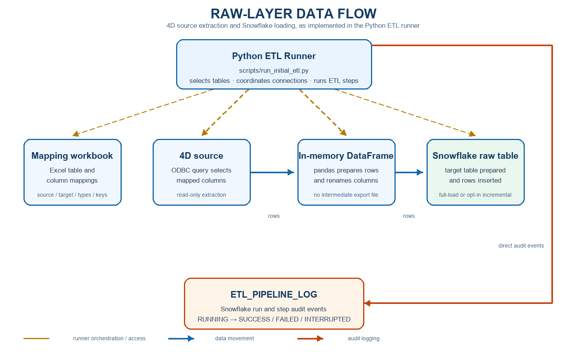

# Raw-layer extraction from 4D to Snowflake

## Purpose and scope

This document describes the implemented Python ETL pipeline that reads selected
4D source tables and loads their mapped columns into Snowflake raw-layer tables.
It is based on `scripts/run_initial_etl.py`, the `etl/` modules, and the
connection modules in this repository.

The normal run is a **full extraction and insert**. Incremental loading is an
optional mode enabled with `--incremental`; it maintains per-table source state
and an append-only `_H` history table. The two modes have different behavior,
described below. This process reads from 4D; it does not write source data back
to 4D.

`PIPELINE_RUN_LOG` is not implemented in this project. The implemented
Snowflake audit table is `ETL_PIPELINE_LOG`. Incremental runs also use
`ETL_INCREMENTAL_BATCH_LOG` for batch counts and watermarks.

## Current data-flow diagram

The solid blue arrows show extracted data movement. Dashed gold arrows show
runner orchestration and access. The orange arrow shows the direct audit-log
connection from the Python runner.



The diagram is also available as an editable vector source:
[RAW_LAYER_DATA_FLOW.svg](RAW_LAYER_DATA_FLOW.svg).

## Components

| Component | Purpose and interaction |
|---|---|
| Python ETL Runner | `scripts/run_initial_etl.py` parses command-line options, reads mappings, coordinates Snowflake and 4D operations, and determines the final run result. |
| Mapping workbook | `4D_to_Snowflake (1-50 tables mapping).xlsx` describes source tables and columns, target names and types, and mapping constraints. A selected target uses its matching worksheet; an all-table run uses the `Snowflake_table_names` worksheet. |
| 4D source | `connections/fourd_connection.py` opens an ODBC connection. The runner issues a mapped `SELECT` query against the source table. |
| In-memory DataFrame | `pandas.read_sql` holds the extracted rows in memory. The runner renames the returned columns to Snowflake target-column names. It does not write an intermediate Excel or JSON data file. |
| Snowflake raw table | `connections/snowflake_connection.py` opens the Snowflake connection. The runner creates or prepares the mapped target table and inserts the rows. |
| `ETL_PIPELINE_LOG` | `etl/audit.py` records pipeline and step audit events in the configured Snowflake database and schema. |
| Incremental state and batch tables | `etl/incremental.py` creates `ETL_INCREMENTAL_TABLE_STATE`, `ETL_SOURCE_ROW_STATE`, and `ETL_INCREMENTAL_BATCH_LOG` when incremental mode is used. |
| Local log | `config/logging_config.py` writes INFO-level console and rotating-file logs to `logs/etl_pipeline.log`, with up to five 5-MB backups. |

## How to start a run

Run commands from the repository root. The `--table` option accepts one target
name (multiword names may be quoted or passed as multiple words); `--tables`
accepts several targets. A selected table normally resolves to the worksheet
whose name matches after normalization. Use `--sheet` when the worksheet name
does not match the target. With neither table option, the runner reads the
`Snowflake_table_names` worksheet.

```powershell
py -3.12 scripts\run_initial_etl.py --table ACCOUNT_CONTACTS
py -3.12 scripts\run_initial_etl.py --tables CLAIMS Alerts
py -3.12 scripts\run_initial_etl.py --table CLAIMS --incremental
py -3.12 scripts\run_initial_etl.py --table CLAIMS --incremental --overlap-seconds 172800
```

Incremental mode is opt-in. The overlap defaults to 86,400 seconds (24 hours)
and can be set to a non-negative number of seconds.

## Execution sequence

### 1. Parse the request

**Purpose and input:** The runner reads `--excel`, `--sheet`, `--table`,
`--tables`, `--incremental`, and `--overlap-seconds`.

**Code operation:** `main()` in `scripts/run_initial_etl.py` resolves a worksheet
for each requested target, or selects the index worksheet when no target is
specified. It configures logging and calls `run_for_table()`.

**Output and next step:** A table selection and mode are passed into the ETL
pipeline. Invalid options or a missing worksheet fail before data extraction;
the command-line entry point logs the exception and exits with an error.

**Logging:** Startup and final messages go to the console and
`logs/etl_pipeline.log`.

### 2. Load configuration and connect to Snowflake

**Purpose and input:** Connection settings are read by `config/settings.py`
from environment variables, normally loaded from `.env`.

**Code operation:** `connect_to_snowflake()` validates required Snowflake
settings, connects with `snowflake.connector`, and executes `SELECT 1` as a
connection check.

**Output and next step:** A reusable Snowflake connection is created for audit
logging, table preparation, and loading.

**Failure handling and logging:** Missing settings or a connection/check error
is raised. The connection module logs connection errors; the runner cannot
write Snowflake audit events until Snowflake is reachable.

### 3. Prepare the audit table and begin the run

**Purpose and input:** Create the event log before performing table-level ETL
work.

**Code operation:** `SnowflakeAuditLogger.ensure_table()` in `etl/audit.py`
creates or migrates `<database>.<schema>.ETL_PIPELINE_LOG`. The runner inserts
an `ETL_PIPELINE` row with status `RUNNING` and a generated `RUN_ID`.

**Output and next step:** The audit table and parent-like run event are ready;
mapping loading begins.

**Failure handling and logging:** If Snowflake is available but audit-table
setup fails, the run stops before extraction. Failures that happen before the
audit table is ready can only be recorded in the local log.

### 4. Read table and column mappings

**Purpose and input:** Determine the 4D source fields and Snowflake target
fields for the selected table or tables.

**Code operation:** `load_metadata_from_excel()` in `etl/metadata.py` reads
the selected worksheet and groups mapping rows by normalized target table. It
uses source table, source column, source type, target column, Snowflake type,
and constraint values. Incomplete and explicitly excluded target-column rows
are not used as data mappings.

**Output and next step:** The runner receives mapping rows for each target and
checks that usable source-to-target mappings exist.

**Failure handling and logging:** A workbook or mapping error is raised from a
`LOAD_MAPPING` audit step. The error and traceback are stored in
`ETL_PIPELINE_LOG` when Snowflake auditing is available.

### 5. Open the Snowflake cursor and connect to 4D

**Purpose and input:** Reuse one Snowflake cursor and one 4D ODBC connection
for the selected tables in the run.

**Code operation:** The runner opens the cursor and calls
`connect_to_4d()` in `connections/fourd_connection.py`. 4D is connected with
`pyodbc`, using either the configured DSN or driver/server/port settings.
`FOURD_QUERY_TIMEOUT_SECONDS` defaults to 1,800 seconds.

**Output and next step:** Both data connections are ready for table-level
processing.

**Failure handling and logging:** Missing settings and connection failures are
raised and logged. The pipeline records the failed step when the audit table
is available. The connection is closed in cleanup when it has been opened.

### 6. Acquire a table run lock

**Purpose and input:** Prevent simultaneous ETL runs from changing the same
target table at once.

**Code operation:** Before preparing each target, the runner calls
`acquire_table_run_lock()` in `etl/incremental.py`. A per-table state row and
lock are used for both full and incremental runs. The lock is renewed during
long operations and released after that target finishes. The incremental state
lock has a 24-hour expiry so an abandoned lock can eventually be reclaimed.

**Output and next step:** The table can proceed under its lock.

**Failure handling and logging:** If another run holds the lock or the lock
cannot be acquired or renewed, the step fails rather than proceeding
unprotected. The error is recorded in the corresponding
`ETL_PIPELINE_LOG` step and raised.

### 7. Create or prepare the Snowflake target

**Purpose and input:** Ensure the mapped target table is ready for the
incoming columns.

**Code operation:** The runner checks `INFORMATION_SCHEMA.TABLES`. If the
target is missing, `build_create_table_sql()` in `etl/ddl.py` builds and runs
`CREATE TABLE IF NOT EXISTS` using mapped Snowflake data types. It includes a
declared primary-key constraint when the mapping contains one, and managed
`CREATED_TIMESTAMP` and `UPDATED_TIMESTAMP` columns when mapped.

For an existing target, the current code drops a `STATUS` column if present,
widens mapped CLOB columns where the mapping requests it, and fills NULLs in
managed ETL timestamp columns. These operations require appropriate Snowflake
privileges. Dropping `STATUS` removes that column and its existing values.

**Output and next step:** The target schema is prepared before extraction and
loading.

**Failure handling and logging:** DDL or preparation errors fail the wrapped
audit step and stop the run. These operations are represented by
`CHECK_TARGET_TABLE`, `CREATE_TARGET_TABLE`, `DROP_STATUS_COLUMN`,
`WIDEN_CLOB_COLUMN`, and `ENFORCE_TIMESTAMP_COLUMN` events as applicable.
Snowflake DDL is not part of the incremental loader's transactional DML
replacement.

### 8. Extract mapped rows from 4D

**Purpose and input:** Retrieve only the fields defined by the mapping.

**Code operation:** `build_source_query()` in `etl/load.py` builds a quoted
4D `SELECT`; `pandas.read_sql()` executes it through the ODBC connection.
Returned columns are renamed to target names in the DataFrame.

**Output and next step:** The complete selected result is held in memory and
passed to the chosen load mode.

**Failure handling and logging:** Query or conversion failures are recorded in
the `EXTRACT_SOURCE_DATA` step for full mode or `INCREMENTAL_LOAD` step for
incremental mode, then raised. There is no partial-success response.

### 9. Load rows in the default full mode

**Purpose and input:** Insert the extracted DataFrame into the Snowflake raw
table when `--incremental` was not specified.

**Code operation:** `load_dataframe_to_snowflake()` in `etl/load.py` inserts
the mapped rows using `executemany`. It supplies current Snowflake timestamps
for the managed `CREATED_TIMESTAMP` and `UPDATED_TIMESTAMP` fields.

**Output and next step:** The run summary includes the inserted row count;
cleanup and final status follow.

**Important behavior:** Full mode does not truncate, merge, or deduplicate the
existing target. Re-running it inserts the source rows again. It is therefore
not an idempotent replacement process.

**Failure handling and logging:** An insertion error is recorded as a failed
`INSERT_TARGET_DATA` step and re-raised. Full mode does not place the data
insert and target preparation into one all-or-nothing transaction.

### 10. Load changed batches in opt-in incremental mode

**Purpose and input:** Maintain current and history tables for mapped targets
when `--incremental` is specified.

**Code operation:** `incremental_load_table()` in `etl/incremental.py` creates
or validates `<TARGET>_H` and the helper tables. It selects a change strategy
from workbook metadata:

- `KEY_TIMESTAMP` is used when the mapping identifies exactly one primary key
  and one timestamp-typed modified column. At initialization it extracts the
  full source. Later runs scan source keys and modification timestamps, fetch
  full records for new/changed candidates and the overlap window, and compare
  row hashes. Null timestamps are rechecked by hash. The full key scan also
  detects source keys that have been deleted.
- `ROW_HASH` is used when that key/timestamp combination is not available. It
  reads and hashes the full mapped source dataset each run, comparing row
  hashes and occurrence counts. It can detect row removals but cannot always
  distinguish a source update from a delete plus insert without a unique key.

Changed rows are loaded to a temporary staging table and validated before the
transactional DML starts. On a changed non-initial batch, the previous current
table contents are appended to `_H`; current rows are deleted and replaced
with the staged changed rows. Source-row state, watermark, and successful
batch status are updated as part of the same DML transaction. Initial load
does not archive its rows. If no changes are found, current and history are
left unchanged and the batch is recorded as a successful no-change run.

**Output and next step:** The runner receives status and row-count details,
then releases the table lock and closes connections.

**Failure handling and logging:** `INCREMENTAL_LOAD` is recorded in
`ETL_PIPELINE_LOG`; batch counts, watermarks, duration, and failure details are
written to `ETL_INCREMENTAL_BATCH_LOG`. A DML failure triggers rollback,
attempts to record a failed batch without advancing the watermark, and
re-raises the error. Staging and helper-object DDL is created outside the
critical transaction because Snowflake DDL has different transaction behavior
from DML. A crash or cleanup failure can therefore leave a temporary/helper
object to inspect.

### 11. Close connections and determine the final result

**Purpose and input:** Release database resources and finish the pipeline.

**Code operation:** The runner closes the 4D connection and Snowflake cursor
through audit steps, releases per-table locks, then updates the
`ETL_PIPELINE` audit row to its final status. The Snowflake connection is
closed in a `finally` block.

**Output:** A successful run returns the per-table summary and the command
prints the loaded row counts or a no-change message.

**Failure handling and logging:** A pipeline exception is logged locally and
the overall audit row is marked `FAILED` when possible. `KeyboardInterrupt`
marks the overall audit row `INTERRUPTED` when possible. Cleanup errors are
also raised/logged; they are not silently reported as a successful pipeline.
The final `ETL_PIPELINE` row contains the run result message and its end time.

## `ETL_PIPELINE_LOG` in detail

The implemented log is
`<SNOWFLAKE_DATABASE>.<SNOWFLAKE_SCHEMA>.ETL_PIPELINE_LOG`. Its schema is
created and migrated by `SnowflakeAuditLogger.ensure_table()` in `etl/audit.py`.

| Column | Meaning |
|---|---|
| `RUN_ID` | UUID shared by audit events from one runner invocation. |
| `RUN_STEP_NO` | Increasing event number within that run. |
| `TABLE_NAME` | Target table or tables associated with the event; may be NULL for general run events. |
| `STEP` | Pipeline or operation name, such as `CONNECT_4D`, `EXTRACT_SOURCE_DATA`, or `INCREMENTAL_LOAD`. |
| `STATUS` | Current or final status for the event. |
| `MESSAGE` | Human-readable step or result message. |
| `ERROR_MESSAGE` | Error details; failed wrapped steps store a traceback. |
| `START_TIME` | Supplied step start time, or the current Snowflake time when the event is inserted. |
| `END_TIME` | NULL while a `RUNNING` event is active; set when the event is finalized. |
| `TIME_STAMP` | Event creation time, with a `CURRENT_TIMESTAMP()` default. |

The logger inserts one row when a wrapped step starts with `STATUS = 'RUNNING'`
and updates that same row on completion. The implemented status values are
`RUNNING`, `SUCCESS`, `FAILED`, and `INTERRUPTED`; directly recorded lifecycle
events may also use `SKIPPED`. The code does not use `STARTED` or `FAILURE` as
status values. The `ETL_PIPELINE` event is finalized to `SUCCESS`, `FAILED`, or
`INTERRUPTED`. During setup, the logger adds missing `RUN_STEP_NO`,
`START_TIME`, and `END_TIME` columns and drops the legacy `S_NO` column if
present; the configured Snowflake role therefore needs permission to perform
these schema changes.

`ETL_PIPELINE_LOG` has no dedicated duration or row-count columns. Step start
and end timestamps are recorded, so duration can be calculated by a query.
The full-load final message includes a loaded count per table. Incremental
batch counts and watermarks are stored separately in
`ETL_INCREMENTAL_BATCH_LOG`, not in dedicated `ETL_PIPELINE_LOG` columns.

If the Snowflake audit table cannot be prepared or a required audit insert
fails, the runner stops rather than continuing without a required audit event.
When a step action fails, the logger attempts to update its event with the
failure and traceback, then re-raises the original error. If that failure
update also fails, the error is written to the local Python log. Pipeline
failure/interruption updates are best-effort so they do not hide the original
failure. Errors before Snowflake or the audit table is available can only be
seen in the local log.

For an incremental batch, `ETL_INCREMENTAL_BATCH_LOG` stores batch ID and run
ID, table, strategy, status, source scan/extraction/change/insert/update/delete
counts, archived row count, change status, old/new watermarks, start/end
times, duration, and error message. Its statuses are `RUNNING`, `SUCCESS`,
`FAILED`, and `INTERRUPTED`; its change statuses include `CHANGED`,
`NO_CHANGE`, `FAILED`, and `INTERRUPTED`.

## Operational notes and limitations

- The connection target is determined by `.env`/environment settings; confirm
  the configured database and schema before executing a load.
- A workbook primary-key label is used as metadata by the loader. It does not
  replace validation of actual source key uniqueness during incremental
  processing.
- Full-load reruns append duplicate rows unless an operator separately manages
  the target contents.
- Incremental current-table semantics change after initialization: current
  contains the latest successfully detected change batch, not a complete copy
  of all source rows. The initial batch is not copied to history; previous
  current batches are appended on later changed runs.
- Hard deletes are counted in incremental batch metadata; this implementation
  does not write deletion tombstones into the current table.
- The parent summary table `PIPELINE_RUN_LOG` and a parent/child run-log
  relationship are not implemented.
- The Snowflake audit log is not a replacement for the local rotating log.
  Early connection failures are only available locally.
